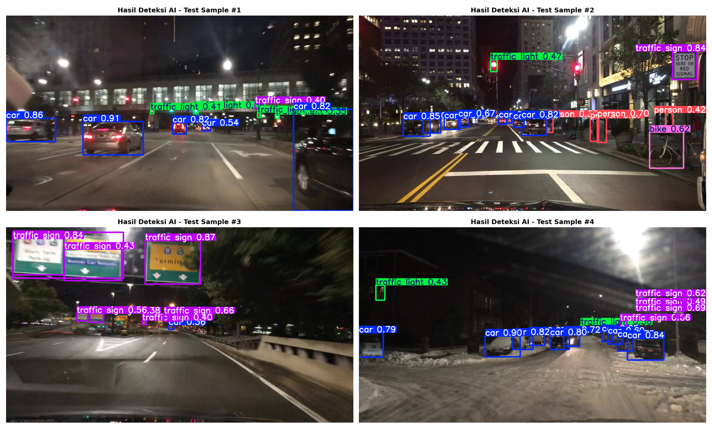
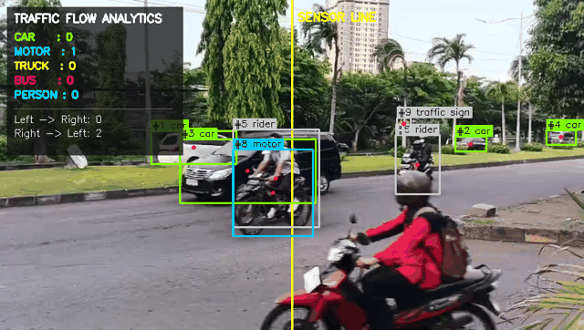
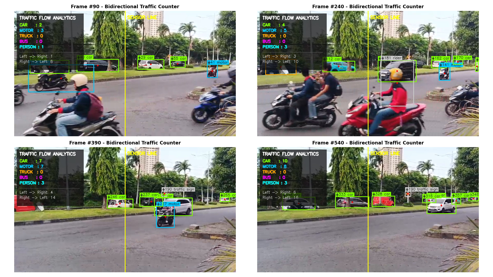

# BDD100K Object Detection & Bidirectional Traffic Analytics

Pipeline computer vision end-to-end berbasis dataset [Berkeley DeepDrive (BDD100K)](https://bdd100k.com) menggunakan `YOLOv8s` dan **ByteTrack**. Mencakup fine-tuning 10 kelas objek jalanan, pelacakan video real-time, penghitungan kendaraan melintas garis, serta analitik arus arah.

## Overview & Setup
Dilatih menggunakan YOLOv8s pada perangkat keras NVIDIA Tesla T4 (`imgsz=640`, `batch=16`, `epochs=15`). Dilengkapi evaluasi metrik (mAP50-95), visualisasi matriks kebingungan, serta demo pelacakan video (`src/traffic_counter.py`) dengan ByteTrack.

* **Kelas (10):** `car`, `bus`, `truck`, `train`, `motor`, `bike`, `person`, `rider`, `traffic light`, `traffic sign`
* **Demo Visual:**
  * 
  * 
  * 
  * 

## Cara Penggunaan

1. Install dependensi:
   ```bash
   pip install ultralytics opencv-python matplotlib pillow lap
   ```

2. Jalankan inferensi gambar:
   ```python
   from ultralytics import YOLO
   model = YOLO("models/best.pt")
   model.predict("path/to/image.jpg", conf=0.35, save=True)
   ```

3. Jalankan pelacakan lalu lintas pada video:
   ```bash
   python src/traffic_counter.py --weights models/best.pt --source path/to/video.mp4 --output output.mp4 --conf 0.35
   ```

## Struktur Repository
```text
├── assets/ (Berisi visualisasi, grafik, dan GIF demo)
├── models/best.pt
├── notebooks/ (Jupyter Notebook untuk eksplorasi & tracking)
├── src/traffic_counter.py
└── README.md
```
