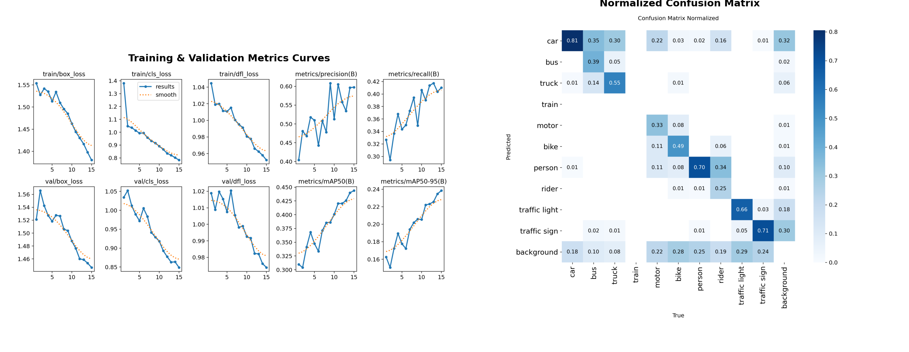

# BDD100K Object Detection with YOLOv8

Object detection model trained on a subset of the [Berkeley DeepDrive (BDD100K)](https://bdd100k.com) dataset using `YOLOv8s`. Built to detect 10 road object classes across varying lighting and weather conditions (night, glare, snow).

## Overview

The raw BDD100K annotations come in a nested JSON format with pixel-level `box2d` coordinates. To train YOLOv8, I wrote a preprocessing script to filter valid bounding boxes, normalize coordinates to `[0, 1]`, and sample 3,000 images (2,500 train / 500 val) from the 100k subset.

**Classes (10):**
`car`, `bus`, `truck`, `train`, `motor`, `bike`, `person`, `rider`, `traffic light`, `traffic sign`

## Training Setup

- **Architecture:** YOLOv8s (pretrained weights)
- **Hardware:** NVIDIA Tesla T4 (Kaggle)
- **Hyperparameters:** `imgsz=640`, `batch=16`, `epochs=15`
- **Training Time:** ~8.5 minutes

## Results

Validation metrics after 15 epochs (`conf=0.35`, ~2.5–14.4 ms inference per image on T4):

| Class | Instances | Precision | Recall | mAP@50 | mAP@50-95 |
| :--- | :---: | :---: | :---: | :---: | :---: |
| **All** | **9,203** | **0.598** | **0.410** | **0.444** | **0.239** |
| Car | 5,112 | 0.743 | 0.626 | 0.686 | 0.407 |
| Person | 637 | 0.674 | 0.418 | 0.499 | 0.240 |
| Traffic Sign | 1,712 | 0.620 | 0.464 | 0.491 | 0.243 |
| Truck | 280 | 0.582 | 0.473 | 0.466 | 0.339 |
| Bike | 71 | 0.737 | 0.338 | 0.466 | 0.181 |
| Traffic Light | 1,341 | 0.582 | 0.461 | 0.454 | 0.154 |
| Bus | 88 | 0.534 | 0.362 | 0.397 | 0.292 |
| Motor | 18 | 0.427 | 0.333 | 0.346 | 0.171 |
| Rider | 32 | 0.480 | 0.219 | 0.232 | 0.122 |



### Notes & Limitations
- **Class Imbalance:** The dataset is heavily skewed toward `car` (5,112 validation instances) compared to `motor` (18) and `rider` (32), which directly impacts recall on minority classes.
- **Next Steps:** Training on the full 70k training split, applying class-weighted sampling, or testing higher input resolution (`imgsz=1280`) to improve small/distant object detection.

## Test Inference

Sample predictions on unseen images from the BDD100K test split:


## Usage

1. Install dependencies:
   ```bash
   pip install ultralytics opencv-python matplotlib
   ```

2. Run inference with the trained weights:
   ```python
   from ultralytics import YOLO

   model = YOLO("models/best.pt")
   model.predict("path/to/image.jpg", conf=0.35, save=True)
   ```

## Repository Structure

```text
├── assets/
│   ├── portfolio_evaluation.png
│   └── portfolio_predictions.png
├── models/
│   └── best.pt
├── notebooks/
│   └── bdd100k_object_detection.ipynb
└── README.md
```
